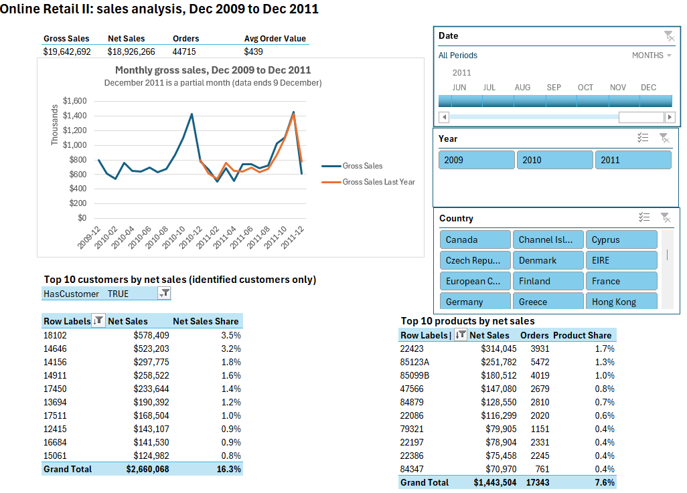

# Retail Sales BI Model and Dashboard

[](./docs)
[](#tools)
[](#the-data)

An end-to-end business intelligence model built in Excel on 1,067,371 online retail transactions, from raw source files through to an interactive dashboard. The project covers the full pipeline: shaping and cleaning in Power Query, a star-schema data model in Power Pivot, a measure layer in DAX, and a filterable dashboard with slicers and a timeline.

Built by **Osman Zakaria, PMP** — [portfolio](https://zosmano.github.io/) · [LinkedIn](https://linkedin.com/in/osmanzakaria)

---

## The dashboard



Every element is cross-filtered through the date timeline and the year and country slicers, connected via Report Connections.

| | |
|---|---|
| Gross Sales | **$19,642,692** |
| Net Sales | **$18,926,266** |
| Returns | **$716,426** (3.6% of gross) |
| Orders | **44,715** |
| Average Order Value | **$439** |

---

## Why this project exists

Most retail reporting answers *what happened*. This model was built to answer *where the business is concentrated* — which customers and which products actually carry revenue, and how much of what looks like growth is really returns, cancellations and duplicate records working their way into the totals.

The headline findings are in [`docs/findings.md`](./docs/findings.md). Two of them changed how I read the dataset:

- **Revenue is concentrated in customers, not products.** The top ten customers account for **$2,660,068 — 16.3%** of net sales. The top ten products account for **$1,443,504 — only 7.6%**. A single customer (`18102`) carries 3.5% on their own, while the largest product reaches just 1.7%. The customer base has a short head; the assortment has a long tail. Those two facts call for different commercial responses.
- **One product looked like three.** StockCode `85099B` appears under three different descriptions in the source data. Grouped by description, each fragment looks mid-tier. Grouped by StockCode — the actual key — it totals **$180,512**. Any assortment decision taken on the description field would have been wrong.

---

## The data

| | |
|---|---|
| **Source** | [Online Retail II](https://archive.ics.uci.edu/dataset/502/online+retail+ii), UCI Machine Learning Repository |
| **Period** | December 2009 – December 2011 |
| **Business** | UK-based online retailer, mainly giftware, selling to consumers and wholesalers |
| **Raw records** | 1,067,371 across two sheets (2009–2010, 2010–2011) |
| **Duplicates removed** | 34,335 |
| **Grain** | One row per invoice line |

The raw files are **not committed to this repository** — see [`data/README.md`](./data/README.md) for how to obtain them and where to place them.

---

## How the model is built

```
Two source sheets
      │
      ▼
 Power Query  ──  append → trim/type → remove 34,335 duplicates → add flag columns
      │
      ▼
 Power Pivot  ──  Sales fact + Calendar dimension (marked as Date Table)
      │
      ▼
     DAX      ──  Gross Sales, Net Sales, Returns, concentration and YoY measures
      │
      ▼
  Dashboard   ──  PivotCharts + slicers + timeline, connected via Report Connections
```

Each stage is documented:

- [`docs/power-query-steps.md`](./docs/power-query-steps.md) — the transformation sequence, in order, with the reasoning for each step
- [`docs/data-dictionary.md`](./docs/data-dictionary.md) — every field, its type, its source and its business meaning
- [`docs/dax-measures.md`](./docs/dax-measures.md) — the measure layer with the full DAX and what each measure is for
- [`docs/findings.md`](./docs/findings.md) — what the analysis actually showed
- [`analysis/`](./analysis) — a Python rebuild of the same model, used to cross-check every headline figure, plus RFM, cohort and return-rate analysis

---

## Decisions worth knowing about

**Returns are modelled, not filtered out.** Cancellations carry an invoice number prefixed with `C` and a negative quantity. Rather than dropping them, the model flags them, so Gross Sales, Returns and Net Sales can each be measured separately. Deleting them would have hidden the return rate entirely.

**Non-product lines are flagged.** Postage, manual adjustments, bank charges and similar entries are not products. They are flagged rather than deleted, so product-level analysis can exclude them while the revenue total stays reconcilable to source.

**Share measures divide by `ALL()`, and the column matters.** A customer-share measure must remove the filter on the customer column; a product-share measure must remove it on the product column. Using the wrong one returns 100% on every row — a mistake that is easy to make and easy to miss, since the output looks plausible.

**Products are grouped by StockCode, never by Description.** See the `85099B` finding above.

---

## Tools

Microsoft Excel — Power Query (M), Power Pivot, DAX, PivotTables and PivotCharts, slicers, timeline.

No add-ins beyond what ships with Excel. The model is reproducible from the source files and the documented steps.

---

## Roadmap

This repository is in progress. Planned additions:

- [x] Dashboard screenshot in `images/`
- [x] An independent Python reproduction and cross-check ([`analysis/`](./analysis))
- [x] RFM segmentation (recency, frequency, monetary) on the customer base
- [x] Cohort retention analysis by first-purchase month
- [x] Return-rate analysis by product and by country
- [ ] The same RFM and cohort views built back into the Excel model and dashboard
- [ ] The workbook itself, or a cut-down version if file size allows
- [ ] A SQL reproduction of the core measures
- [ ] Basket analysis on co-purchased StockCodes

---

## Repository layout

```
retail-sales-bi-model/
├── README.md
├── analysis/    independent Python reproduction and cross-check
├── data/        source files (not committed) and how to obtain them
├── docs/        model documentation and findings
└── images/      dashboard screenshots
```

---

## License and attribution

The analysis, documentation and model design in this repository are my own work.

The Online Retail II dataset is provided by the UCI Machine Learning Repository and is subject to its own terms. Please cite the original source if you use the data.
